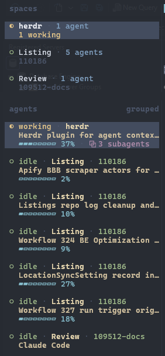

# herdr-vitals

Agent vitals for the [Herdr](https://herdr.dev) sidebar: each Claude Code agent's context window usage, git branch
running subagents and monitors, plus a per-space agent count with a working/blocked breakdown.



Everything is published as Herdr metadata tokens (`$ctx`, `$branch`, `$subagents`, `$monitors`, `$agents`, ...), so where and how
each value appears is up to your `config.toml`. Herdr's agent rows have no built-in branch token (only space rows
do), which is why the plugin publishes one.

## How it works

A startup process polls `session.snapshot` every 2s. For each pane running Claude with a reported session id, it tails
`~/.claude/projects/*/<session-id>.jsonl` (only the bytes appended since the last poll) and takes the latest main-thread
assistant line's `input + cache_read + cache_creation` tokens, or a compaction's `postTokens`. It then publishes that
as a share of the model's context window to the pane metadata token `ctx` via `pane.report_metadata`.

For every agent pane it also publishes `branch`. The branch is read from `.git` files (no `git` process) in the
directory Claude itself last worked in, taken from the transcript's `cwd`, so worktrees are followed. It falls back
to the pane's directory. Detached HEADs show a short hash; a rebase shows the branch being rebased.

For Claude panes it also publishes `subagents` (`⧉ 2 subagents`) while any are running. Subagents run inside the
parent process, so they are tracked from the parent transcript:

- an `Agent` call counts until its tool result, or for background launches until the `<task-notification>` naming it;
- a `Workflow` counts as the number of its agents that wrote to their transcripts in the last minute (at least 1),
  until its notification;
- a launch whose own transcript has been quiet for 10 minutes (a crashed or killed parent) stops counting, and is
  forgotten after an hour.

It also publishes `monitors` (`⦿ 1 monitor`) while any `Monitor` watch is running, tracked the same way:

- a `Monitor` call counts from the call until its script exits (a notification with a status), its expiry notice, or
  a `TaskStop` of its task that succeeded. Event notifications do not end it;
- every monitor also stops counting at its timeout (Claude Code caps it at 30 minutes), timed from the call's
  timestamp, because a timeout can leave no transcript marker.

For every space it publishes the workspace token `agents`: the number of panes running any agent, e.g. `5 agents`.
It also publishes `agents_working` (`2 working`) and `agents_blocked` (`1 blocked`), each only while its count is
above zero, so they can be styled separately. Spaces with no agents show nothing.

```toml
[ui.sidebar.spaces]
rows = [
  ["state_icon", "workspace", "$agents"],
  ["branch", "git_status", { token = "$agents_working", fg = "#ebcb8b" }, { token = "$agents_blocked", fg = "#bf616a", bold = true }]
]
```

- **Window size:** 1M for current models; 200k for Haiku 4.5, Sonnet/Opus 4.5 and older; `[1m]`-suffixed ids are 1M. Unknown models use `default_window`.
- **Lifecycle:** values carry a TTL (30s, or 5× the poll interval), so they vanish if the plugin dies. Tokens are cleared when Claude leaves a pane and on clean shutdown. The process exits when another Herdr server takes the socket (the new server starts its own copy).

## Install

Requires Go (Herdr builds the plugin at install time) and Herdr 0.9+.

```sh
herdr plugin install mcditchman/herdr-vitals
```

For a local checkout, link it and build it yourself (Herdr does not build linked plugins):

```sh
herdr plugin link /path/to/herdr-vitals
go build -o herdr-vitals ./cmd/herdr-vitals   # herdr-vitals.exe on Windows
```

The plugin starts with the Herdr server. Then show the tokens in `config.toml`:

```toml
[ui.sidebar.agents.rows_by_agent]
claude = [
  ["state_icon", "state_text", "workspace", { token = "$branch", fg = "#a3be8c" }],
  [{ token = "tab", fg = "#d5c4a1", bold = true }],
  [{ token = "$ctx", fg = "#88c0d0" }, { token = "$subagents", fg = "#b48ead" }, { token = "$monitors", fg = "#d08770" }]
]
```

and run `herdr server reload-config`.

## Configuration

Optional `config.json` in `herdr plugin config-dir mcditchman.vitals`. Invalid values are logged and the default is kept.

| Key | Default | Meaning |
|---|---|---|
| `poll_ms` | `2000` | Poll interval (min 250) |
| `bar_width` | `8` | Bar cells, 0–20; `0` shows the percentage only |
| `token` | `"ctx"` | Context usage token name, referenced as `$<token>` in sidebar rows |
| `branch_token` | `"branch"` | Git branch token name; `""` turns branch publishing off |
| `subagents_token` | `"subagents"` | Running subagent count token name; `""` turns it off |
| `monitors_token` | `"monitors"` | Running `Monitor` watch count token name; `""` turns it off |
| `agents_token` | `"agents"` | Workspace token with each space's agent count (`3 agents`), for `[ui.sidebar.spaces]` rows; the breakdown tokens are named `<agents_token>_working` / `_blocked`. Max 24 characters; `""` turns all three off |
| `default_window` | `1000000` | Window for models not otherwise known |
| `windows` | `{}` | Window overrides by model id prefix, longest match wins, e.g. `{"claude-opus-5-5": 1000000}` |
| `claude_dir` | `CLAUDE_CONFIG_DIR` or `~/.claude` | Claude Code config directory |

## Development

```sh
go test ./...
```

The Herdr socket client and transcript locator are adapted from [kryptamine/herdr-auto-title](https://github.com/kryptamine/herdr-auto-title) (MIT).
